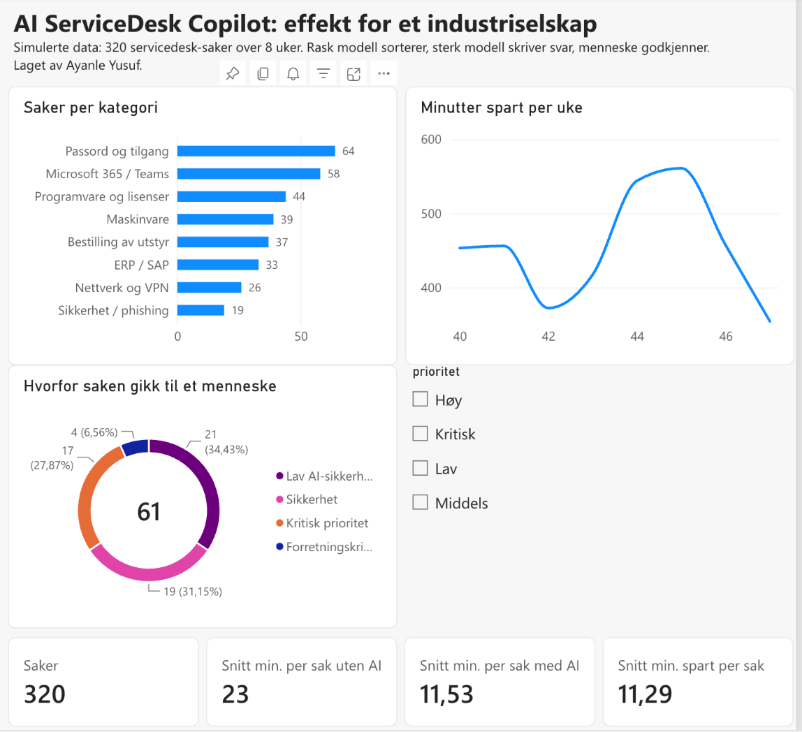

# AI ServiceDesk Copilot

Automates the manual first step of an IT service desk: **triage, routing and first-draft replies** – with a human always approving before anything reaches the user.

Built by [Ayanle Yusuf](https://linkedin.com/in/ayanle-yusuf-ba003228b) – Computer Engineering student at OsloMet and 1st/2nd line IT ServiceDesk technician.

## Why

In 1st/2nd line support, a large share of time goes to reading each ticket, deciding category and priority, routing it to the right team and writing the same first reply again and again. This project automates that part so people can spend their time on the actual problem.

## How it works

```
New ticket ──► 1. Triage (fast, cheap model)   category · priority · team · escalate?
                    │
                    ▼
               2. Routing rules (plain Python)  critical / security / access ──► human, no AI reply
                    │ safe
                    ▼
               3. Draft reply (stronger model)  only when it is safe to prepare one
                    │
                    ▼
               4. Human approves and sends
```

**Design choices**

| Choice | Why |
|---|---|
| Fast model (`claude-haiku-5-5`) for triage | Triage is most of the volume, so it must be cheap and quick |
| Stronger model (`claude-sonnet-5-5`) only for drafts | Quality matters where the user reads the text – and only safe tickets get one |
| Deterministic routing rules after the model | Security, access and critical cases are never answered by AI, even if the model gets it wrong |
| Structured JSON output, validated | Downstream systems (ServiceNow, Pureservice) need fields, not prose |
| Cost and time report per run | An automation is only worth running if it is cheaper than the manual work |

I learned the cost point the hard way: an earlier agent of mine (monitoring a constantly updating ticket page) burned through tokens because it checked too often. Here the expensive model is used only where it adds value.

## Run it

```bash
pip install -r requirements.txt
export ANTHROPIC_API_KEY=...        # your own key
python -m copilot.main data/tickets.json
python -m copilot.main data/tickets.json --dry-run   # no API calls: shows routing with rule-based triage
```

Output: a table per ticket (category, priority, team, route) plus draft replies, and a summary with tokens used, estimated cost and estimated manual minutes saved (`--minutes-per-ticket`, default 4 – an assumption you should set from your own service desk).

## Tests

```bash
python -m pytest -q
```

The routing rules are covered by tests, because they are the safety net.

## Data

`data/tickets.json` contains **fictional** tickets written to resemble typical service desk cases (password, network outage, printer, access request, phishing, onboarding, software, meeting room AV). No real user data.

## Impact analysis (Power BI)



To show what the Copilot could mean for a real service desk, I simulated **320 tickets over 8 weeks** for an industrial company (`data/servicedesk_demo_320.csv`) and built a Power BI report on top of it.

| Metric (simulated) | Result |
|---|---|
| Triage category correct | 93 % |
| Resolved fully automatically (password, orders, simple M365) | 19 % |
| Sent to a human (all phishing, all critical, low AI confidence) | 19 % |
| Avg. handling time per ticket | ~23 min → ~11.5 min |
| Time saved | ~60 hours over 8 weeks (~7.5 h/week) |

**These numbers are simulated, not measured.** The point is the method: define the metrics before rollout, then measure the same things on real data.

## What this could mean for Siemens

- **Start small:** one high-volume, low-risk queue (password/access, M365, equipment orders) where triage and first replies are repetitive.
- **Safety first:** security, access and business-critical systems (e.g. ERP/SAP) always go to a person – enforced in code, not left to the model.
- **Measure it:** a Power BI report like the one above becomes the decision basis for whether to scale the automation to more queues.
- **Fits the existing stack:** the same flow can run on Power Automate / Copilot Studio with ServiceNow, or as Python against the ticket system's API.

## Next steps

- Connect to a ticket system API (ServiceNow / Pureservice) instead of a JSON file
- Measure triage accuracy and time saved on real (anonymised) ticket data
- Evaluation set with known correct labels to measure triage accuracy
